# Temperator

🇫🇷 [Version française](README.md)

```text
  ______                                     __
 /_  __/__  ____ ___  ____  ___  _________ _/ /_____  _____
  / / / _ \/ __ `__ \/ __ \/ _ \/ ___/ __ `/ __/ __ \/ ___/
 / / /  __/ / / / / / /_/ /  __/ /  / /_/ / /_/ /_/ / /
/_/  \___/_/ /_/ /_/ .___/\___/_/   \__,_/\__/\____/_/
                  /_/
```

Your PC's temperatures and usage, always on screen: a small, discreet widget at the top right.

<p align="center">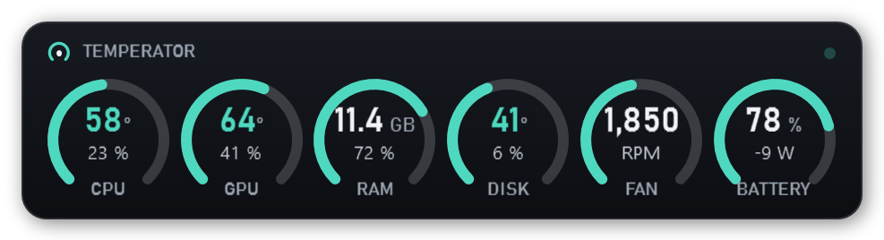</p>

## What it shows

- **CPU, GPU, RAM, drive, fan**: temperature and load, updated every second.
- **Network** (download ↓, upload ↑), laptop **battery** (level, charging or watts drawn),
  and **power draw** of the processor and graphics card in watts.
- **Colors**: teal when all is well, orange when it's warming up, red when it's too hot.
  The accent color can be changed (blue, purple, pink, green, orange, white).
- **FPS** (frames per second) of the fullscreen game: DirectX 9 to 12 games.
- **Round gauges** (default), **rows and bars**, or a **thin bar** on a single line.
- You pick the **order** of the items, and which **graphics card**, **drive** and **network adapter** are shown.
- **Dark, light, or Windows-matching theme** for the opaque background.

<p align="center">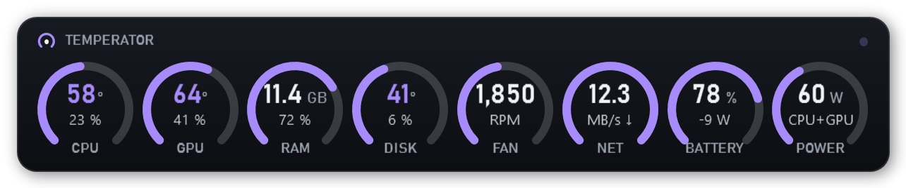</p>
<p align="center">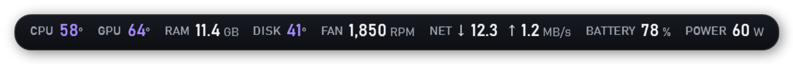</p>
<p align="center">
  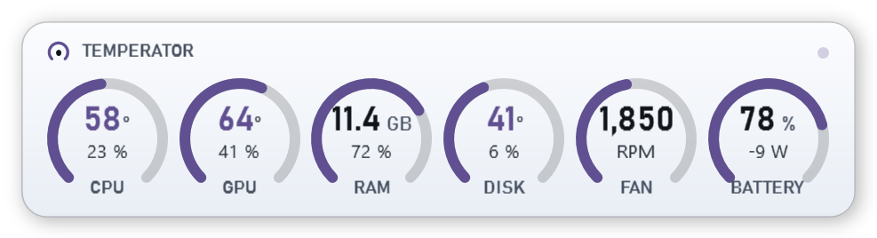
  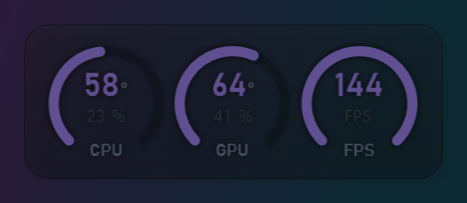
</p>
<p align="center"><sub>Thin bar · light theme · "Game" profile with FPS</sub></p>

## What it can do

- **Flames when too hot**: with round gauges, only the gauge concerned catches fire; in rows, the whole bottom of the widget.
  The **thresholds** are adjustable (some laptop processors normally run around 90 °C).
- **Windows alert** when a component stays too hot for more than 30 seconds, even with the widget hidden.
- **History**: hover a gauge for its last 5 minutes, and in the *PC map* the last 10 minutes, last hour or last 24 hours
  (kept across restarts), with **CSV export** for Excel.
- **"Game" profile**: when a game or video goes fullscreen, the widget switches its settings by itself
  (by default CPU, GPU and FPS, smaller, light background, always on top), then goes back to its "Desktop" profile.
  You choose what it shows, its layout, size and background. It can also hide, or change nothing.
- **Opaque, translucent or no background**: when translucent or with no background, the widget looks at the screen around it
  and switches to light or dark colors to stay readable. The **background opacity** is adjustable on its own.
- **Above everything, whatever happens**: it comes back over any window covering it.
- **Click-through**: the mouse goes through the widget (hold **Ctrl** to grab it).
- **Keyboard shortcut**: **Ctrl+Alt+T** shows or hides it from anywhere.
- **Automatic updates** from GitHub, with SHA-256 fingerprint verification.
- **English or French**: the Windows language by default, changeable in the settings.

Drag the widget to move it, **double-click** for the *PC map*, **right-click** for the menu.
The icon near the clock hides or shows it.

<p align="center">
  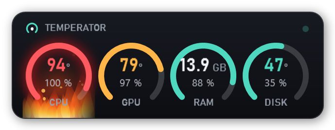
  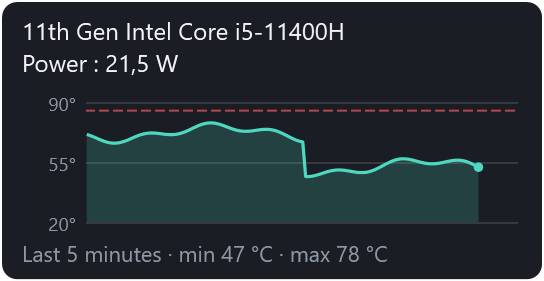
</p>
<p align="center">
  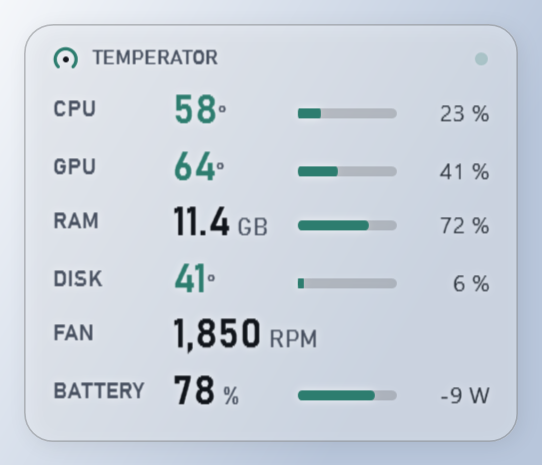
  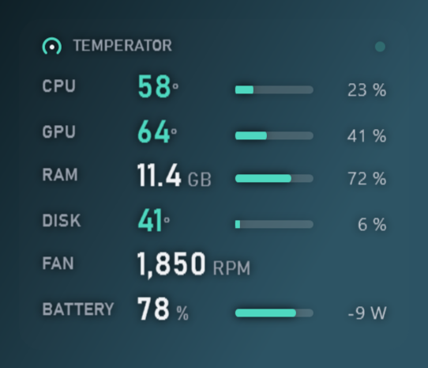
  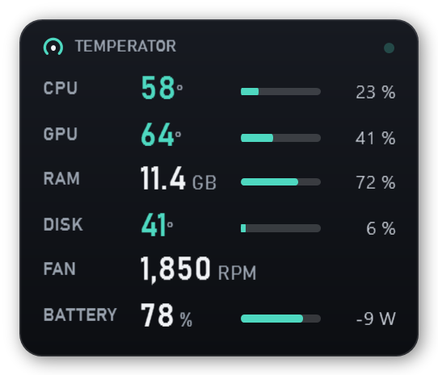
</p>
<p align="center"><sub>Too hot · history on hover · translucent · no background · rows and bars</sub></p>

## Simple or full

On first launch, Temperator asks how you want to use it:

- **Simple** (recommended): the widget ready to go, with a short menu (layout, size, always on top, hide).
- **Full**: a **Settings** window with every option, organized in tabs.

You can switch at any time: right-click → *Full mode* in simple mode, or *Settings → General* in full mode.

<p align="center">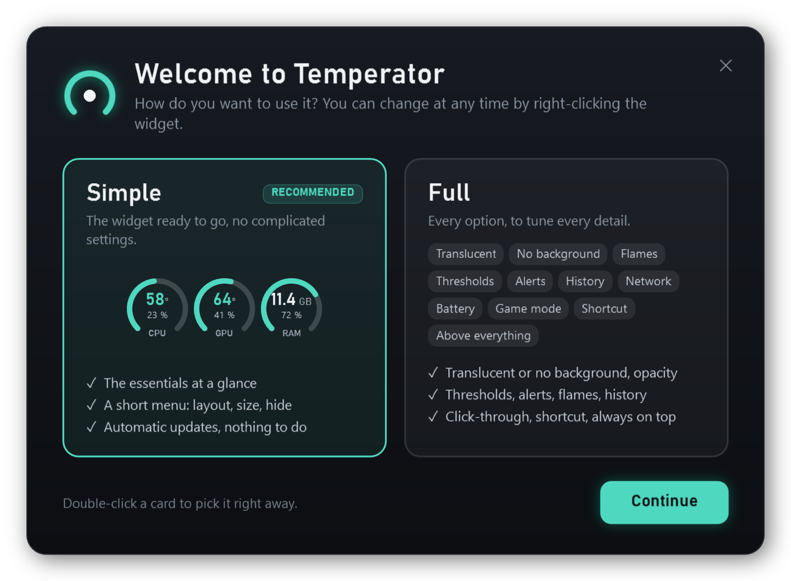</p>
<p align="center">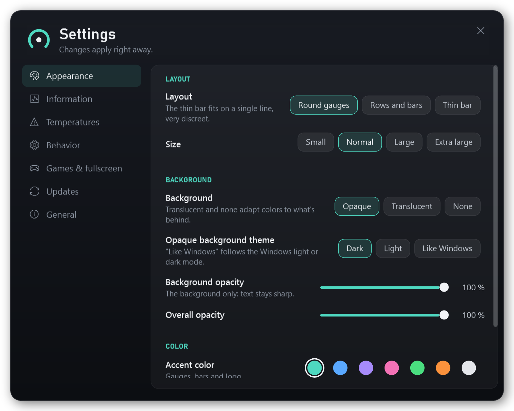</p>

## Installation

1. Download **`Temperator-Setup-x.y.z.exe`** from the [Releases](https://github.com/Buntasam/Temperator/releases/latest) page.
2. Run it and accept the administrator prompt.
3. Pick your options, accept the [license](LICENSE), then click **Install**.

<p align="center">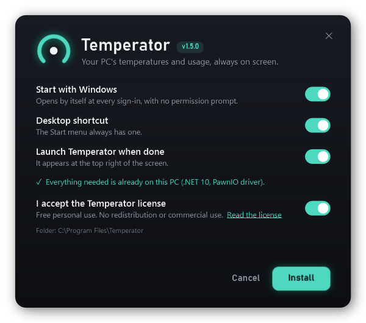</p>

The installer also adds what's missing:

| Component | Why | Size |
|---|---|---|
| [.NET 10 Desktop Runtime](https://dotnet.microsoft.com) (Microsoft) | runs Temperator | about 57 MB |
| [PawnIO](https://pawnio.eu) driver (open source, signed) | CPU temperature and fans | about 3 MB |

> **"Windows protected your PC"?** The installer isn't digitally signed, so SmartScreen may show this.
> Click *More info*, then *Run anyway*. The SHA-256 fingerprint of each version is published with the release.

**Uninstall**: *Settings → Apps → Temperator*, or run the installer again and choose *Uninstall*.
.NET and PawnIO stay installed, since other software may use them.

**Silent install**: `Temperator-Setup-x.y.z.exe /S`. Options: `/noautostart /nodesktop /nolaunch`
(and `/uninstall /S` to uninstall without a window). A silent install means you accept the [license](LICENSE).
The log is written to `%TEMP%\temperator-setup.log`.

> What Windows doesn't let any app cover: the Start menu, search, Alt+Tab, the notification center
> and games in *exclusive* fullscreen. Games in "borderless windowed" mode work.

## PC map

Double-click the widget: the history, then all detected hardware and all its sensors, live.

<p align="center">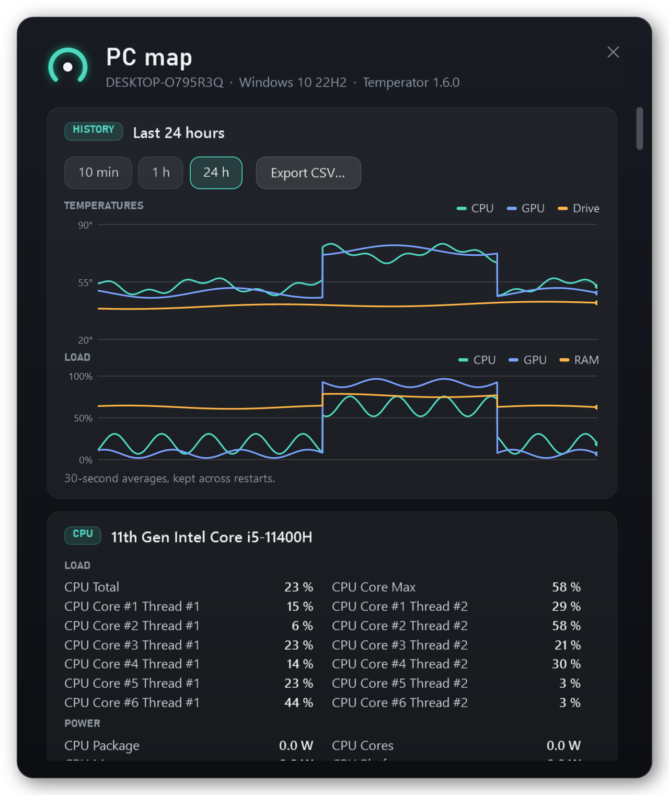</p>

## A problem?

*Settings → General → Diagnostic report → Copy*, then paste it into an [issue](https://github.com/Buntasam/Temperator/issues).
It contains the version, Windows, the detected hardware, the values read, the settings and the latest errors.

## For developers

You need 64-bit Windows 10/11 and the [.NET 10 SDK](https://dotnet.microsoft.com/download/dotnet/10.0) (`winget install Microsoft.DotNet.SDK.10`).

```powershell
# run the widget (Debug: not elevated, so no CPU temperature)
dotnet run --project src/Temperator

# build the installer: dist\Temperator-Setup-<version>.exe, SHA256SUMS.txt and the winget manifests
powershell -ExecutionPolicy Bypass -File build.ps1
```

| Folder | Contents |
|---|---|
| `src/Temperator` | the widget (WPF, .NET 10, [LibreHardwareMonitor](https://github.com/LibreHardwareMonitor/LibreHardwareMonitor)) |
| `src/Setup` | `Temperator-Setup.exe`: the installer (C#, WPF, .NET Framework 4.8), which contains the app |
| `tests/Temperator.Tests` | the tests (xUnit) |
| `tools/make-icon.ps1` | generates the icon |

Tests: `dotnet test tests/Temperator.Tests` (updates, formatting, settings, history, thresholds…).

Screenshots: `Temperator.exe --snapshot <folder> --demo` (add `--en` for English),
and `Temperator-Setup.exe /preview <folder> /lang fr|en` (Debug build) for the installer.

Check the FPS counter (as administrator): `Temperator.exe --fps-test <file>`.

Settings are in `%ProgramData%\Temperator\settings.json`, the history in `historique.csv` and errors in `erreurs.log`,
in the same folder.

**Publishing a version**: change `<Version>` in `src/Temperator/Temperator.csproj` and `src/Setup/Setup.csproj`, run
`build.ps1`, then attach **`Temperator-Setup-x.y.z.exe` and `SHA256SUMS.txt`** to the GitHub release. Automatic updates
refuse to install a version without a matching SHA-256 fingerprint.

**winget**: `build.ps1` prepares the manifests in `dist\winget\`. Once the release is published, check them with
`winget validate dist\winget\manifests\b\Buntasam\Temperator\<version>`, then submit them to
[microsoft/winget-pkgs](https://github.com/microsoft/winget-pkgs) (for example with `wingetcreate submit`).
Once accepted: `winget install Buntasam.Temperator`.

## Contributing

Improvements are proposed **only on GitHub**, through an issue or a pull request: see [CONTRIBUTING.md](CONTRIBUTING.md).

## License

Temperator is **not open source**. The code is visible, but all rights are reserved (see [LICENSE](LICENSE)).

- ✅ Download, install and use Temperator for free, for personal use.
- ✅ Read the code, and modify it for yourself only.
- ✅ Propose improvements on this repository (fork only to open a pull request).
- ✅ Show the widget in screenshots, videos or streams, and share the link to this repository.
- ❌ Republish, redistribute or host Temperator elsewhere, modified or not.
- ❌ Any commercial use without the author's written permission.

Third-party components (LibreHardwareMonitor, HidSharp…) keep their own licenses: see [LICENCES-TIERS.txt](LICENCES-TIERS.txt).
