# Temperator

```text
  ______                                     __
 /_  __/__  ____ ___  ____  ___  _________ _/ /_____  _____
  / / / _ \/ __ `__ \/ __ \/ _ \/ ___/ __ `/ __/ __ \/ ___/
 / / /  __/ / / / / / /_/ /  __/ /  / /_/ / /_/ /_/ / /
/_/  \___/_/ /_/ /_/ .___/\___/_/   \__,_/\__/\____/_/
                  /_/
```

Les températures et l'utilisation de ton PC, toujours à l'écran : un petit widget discret en haut à droite.

<p align="center">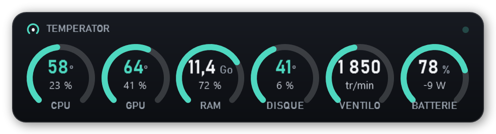</p>

- **CPU, GPU, RAM, disques, ventilateur** : température, utilisation, mise à jour chaque seconde.
- **Couleurs** : turquoise quand tout va bien, orange quand ça chauffe, rouge quand c'est trop chaud.
- **Flammes quand c'est trop chaud** (par défaut CPU ≥ 85 °C, GPU ≥ 87 °C, disque ≥ 60 °C) : en jauges rondes, seule la jauge
  concernée prend feu et rougeoie ; en lignes, c'est tout le bas du widget.
- **Seuils réglables** (clic droit → *Seuils « trop chaud »*) : certains processeurs portables tournent normalement à 90 °C.
- **Alerte Windows** quand un composant reste trop chaud plus de 30 secondes, même si le widget est masqué.
  Un clic sur l'alerte ouvre le *Plan du PC*.
- **Historique** : survole une jauge pour voir sa courbe des 5 dernières minutes (avec min et max).
  Le *Plan du PC* montre les 10 dernières minutes de toutes les températures et de l'utilisation.
- **Mode translucide** : un verre teinté qui regarde le fond de l'écran autour de lui. Il passe en couleurs claires ou sombres
  pour rester lisible, prend la teinte du fond et s'opacifie si le fond est chargé. Ça s'adapte même pendant que tu le déplaces.
- **Jauges rondes** (affichage par défaut) : une tuile par composant, avec un anneau qui se remplit selon la température
  (turquoise → orange → rouge), la température au centre et l'utilisation juste en dessous.
  L'affichage en **lignes et barres** reste disponible (clic droit → *Affichage*).
- **Opacité du fond réglable à part** (curseur de 0 à 100 %), indépendante de l'opacité générale. Dès que le fond laisse voir
  l'écran, les couleurs s'adaptent automatiquement à ce qu'il y a derrière.
- **Sans aucun fond (100 % transparent)** : seuls le texte et les barres flottent sur l'écran. Les couleurs s'adaptent
  au fond de la même façon, avec un halo autour du texte pour qu'il reste lisible.
- **Au-dessus de tout, quoi qu'il arrive** : si une fenêtre d'une autre application passe devant le widget, même une autre
  fenêtre « toujours au premier plan », il repasse au-dessus. S'il est réduit, il revient.
- **Clics traversants** : la souris passe à travers le widget, pour jouer ou travailler dessous.
  Maintiens **Ctrl** pour le saisir, le déplacer ou ouvrir son menu.
- **Raccourci clavier** : **Ctrl+Alt+T** affiche ou masque le widget, de n'importe où (modifiable dans le menu).
- **Mises à jour automatiques** : une fois par jour, Temperator regarde s'il existe une nouvelle version sur GitHub,
  vérifie son empreinte SHA-256 et l'installe tout seul, sans demande d'autorisation. Tu peux choisir d'être seulement
  prévenu, ou de désactiver les mises à jour (clic droit → *Mises à jour*).
- **Glisser** pour le déplacer. La position est retenue.
- **Double-clic** pour le *Plan du PC* : tout le matériel détecté et tous ses capteurs, en direct.
- **Clic droit** pour les réglages : affichage (lignes ou jauges), lignes affichées, taille, opacité générale, opacité du fond,
  fréquence, °C/°F, fond (opaque, translucide ou aucun), flammes, seuils, premier plan, clics traversants, raccourci, mises à jour…
- **Icône près de l'horloge** : un clic masque ou réaffiche le widget, et le clic droit ouvre le même menu.
- Démarre avec Windows, **sans demande d'autorisation à chaque fois**.

<p align="center">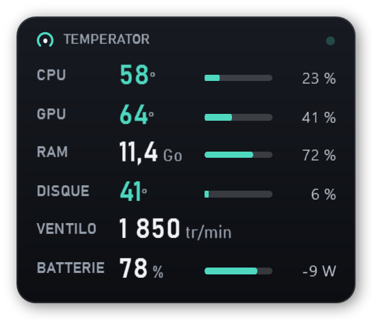</p>
<p align="center"><sub>Affichage en lignes et barres</sub></p>
<p align="center">
  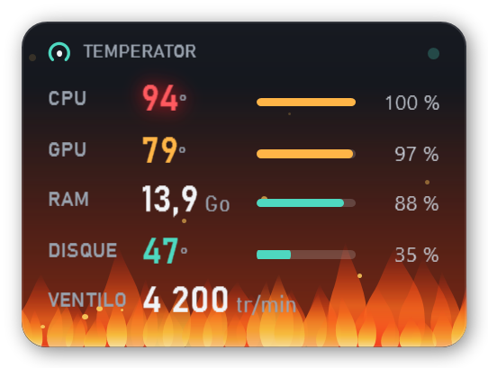
  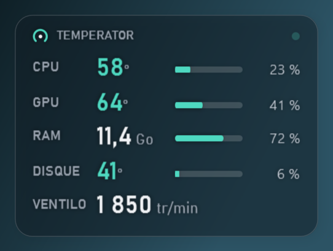
  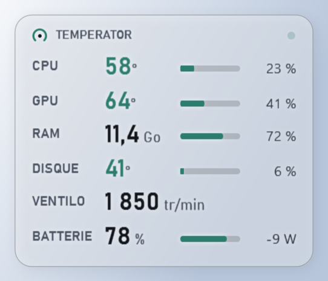
</p>
<p align="center"><sub>Trop chaud · translucide sur fond sombre · translucide sur fond clair</sub></p>
<p align="center">
  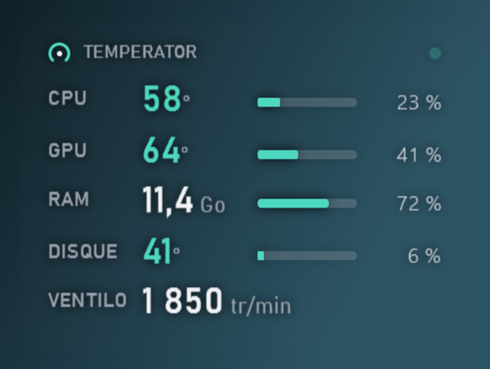
  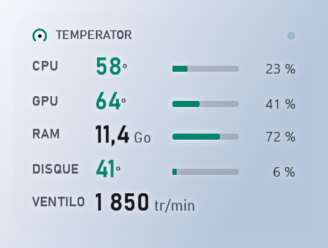
</p>
<p align="center"><sub>Sans aucun fond : sur fond sombre · sur fond clair</sub></p>
<p align="center">
  <br>
  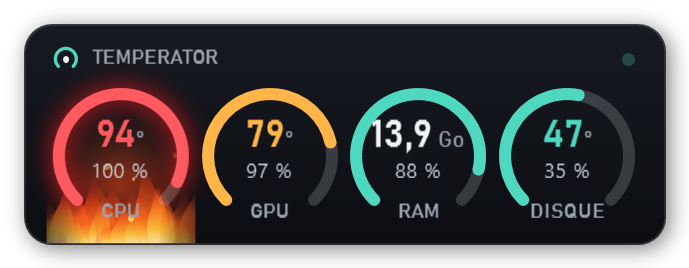
  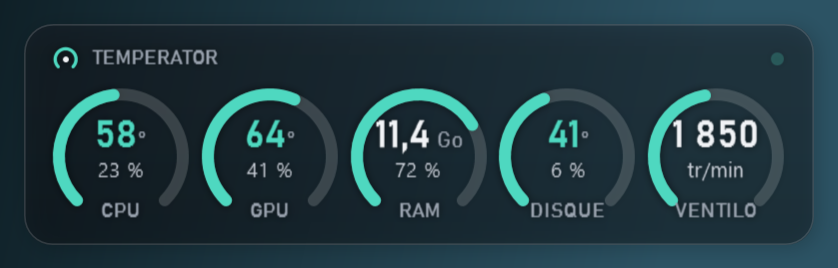
</p>
<p align="center"><sub>Jauges rondes · trop chaud (seule la jauge du CPU brûle) · fond à 40 %</sub></p>
<p align="center">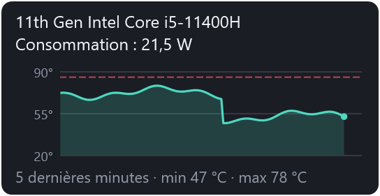</p>
<p align="center"><sub>Au survol d'une jauge : la courbe des 5 dernières minutes</sub></p>

> Ce que Windows ne permet pas de recouvrir : le menu Démarrer, la recherche, Alt+Tab, le centre de notifications
> et les jeux en plein écran *exclusif*. Les jeux en mode « fenêtré sans bordure » fonctionnent.

## Installation

1. Télécharge **`Temperator-Setup-x.y.z.exe`** depuis la page [Releases](https://github.com/Buntasam/Temperator/releases/latest).
2. Lance-le et accepte la demande d'administrateur.
3. Choisis tes options, puis clique sur **Installer**.

<p align="center">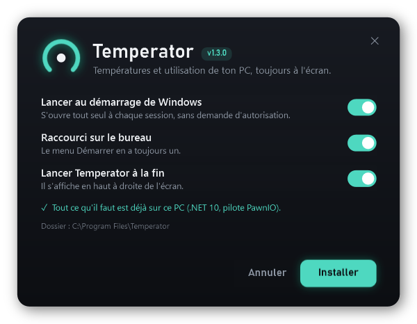</p>

L'installeur ajoute aussi ce qui manque :

| Composant | Pourquoi | Taille |
|---|---|---|
| [.NET 10 Desktop Runtime](https://dotnet.microsoft.com) (Microsoft) | fait tourner Temperator | environ 57 Mo |
| Pilote [PawnIO](https://pawnio.eu) (open source, signé) | température du CPU et ventilateurs | environ 3 Mo |

> **« Windows a protégé votre ordinateur » ?** L'installeur n'est pas signé numériquement, donc SmartScreen
> peut l'afficher. Clique sur *Informations complémentaires*, puis sur *Exécuter quand même*.
> L'empreinte SHA-256 de chaque version est publiée avec la release.

**Désinstaller** : *Paramètres → Applications → Temperator*, ou relance l'installeur et choisis *Désinstaller*.
.NET et PawnIO restent installés, car d'autres logiciels peuvent s'en servir.

**Installation silencieuse** : `Temperator-Setup-x.y.z.exe /S`. Options possibles : `/noautostart /nodesktop /nolaunch`
(et `/uninstall /S` pour désinstaller sans fenêtre). Le journal est écrit dans `%TEMP%\temperator-setup.log`.

L'installeur est un programme C# (.NET Framework 4.8, déjà présent sur Windows 10 et 11) : aucun script PowerShell.

## Plan du PC

Double-clic sur le widget : l'historique des 10 dernières minutes, puis tout le matériel détecté et tous ses capteurs, en direct.

<p align="center">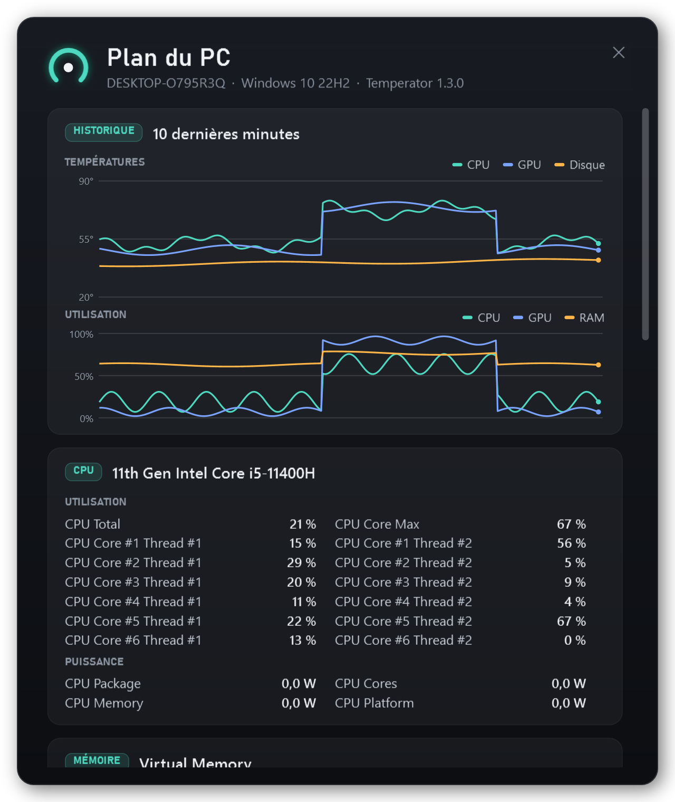</p>

## Pour les développeurs

Il faut Windows 10/11 64 bits et le [SDK .NET 10](https://dotnet.microsoft.com/download/dotnet/10.0) (`winget install Microsoft.DotNet.SDK.10`).

```powershell
# lancer le widget (Debug : sans élévation, donc sans température CPU)
dotnet run --project src/Temperator

# construire l'installeur : dist\Temperator-Setup-<version>.exe
powershell -ExecutionPolicy Bypass -File build.ps1
```

| Dossier | Contenu |
|---|---|
| `src/Temperator` | le widget (WPF, .NET 10, [LibreHardwareMonitor](https://github.com/LibreHardwareMonitor/LibreHardwareMonitor)) |
| `src/Setup` | `Temperator-Setup.exe` : l'installeur (C#, WPF, .NET Framework 4.8), qui contient l'application |
| `tools/make-icon.ps1` | génère l'icône |

Captures d'écran : `Temperator.exe --snapshot <dossier>` (ajoute `--demo` pour des valeurs d'exemple),
et `Temperator-Setup.exe /preview <dossier>` (version Debug) pour l'installeur.

**Publier une version** : change `<Version>` dans `src/Temperator/Temperator.csproj` et `src/Setup/Setup.csproj`, lance
`build.ps1`, puis joins à la release GitHub **`Temperator-Setup-x.y.z.exe` et `SHA256SUMS.txt`**. La mise à jour automatique
refuse d'installer une version sans empreinte SHA-256 correspondante.

Les réglages sont dans `%ProgramData%\Temperator\settings.json`, et les erreurs dans `erreurs.log` au même endroit.

## Licences

Les composants tiers et leurs licences sont listés dans [LICENCES-TIERS.txt](LICENCES-TIERS.txt).
