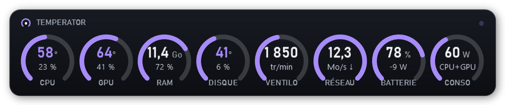
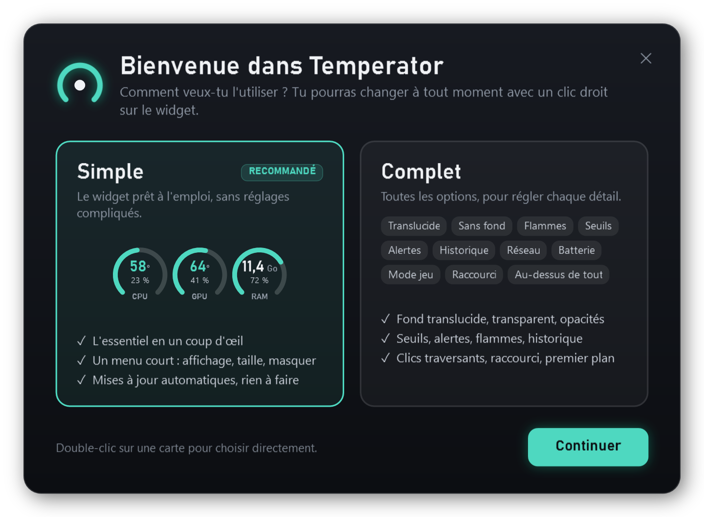
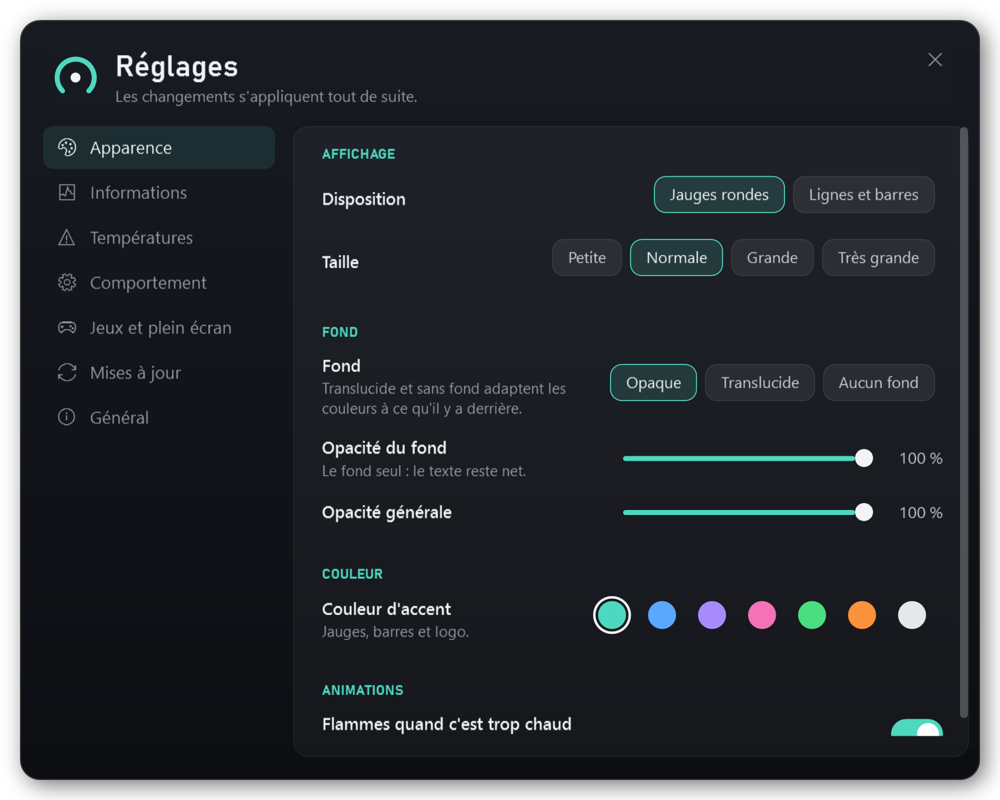
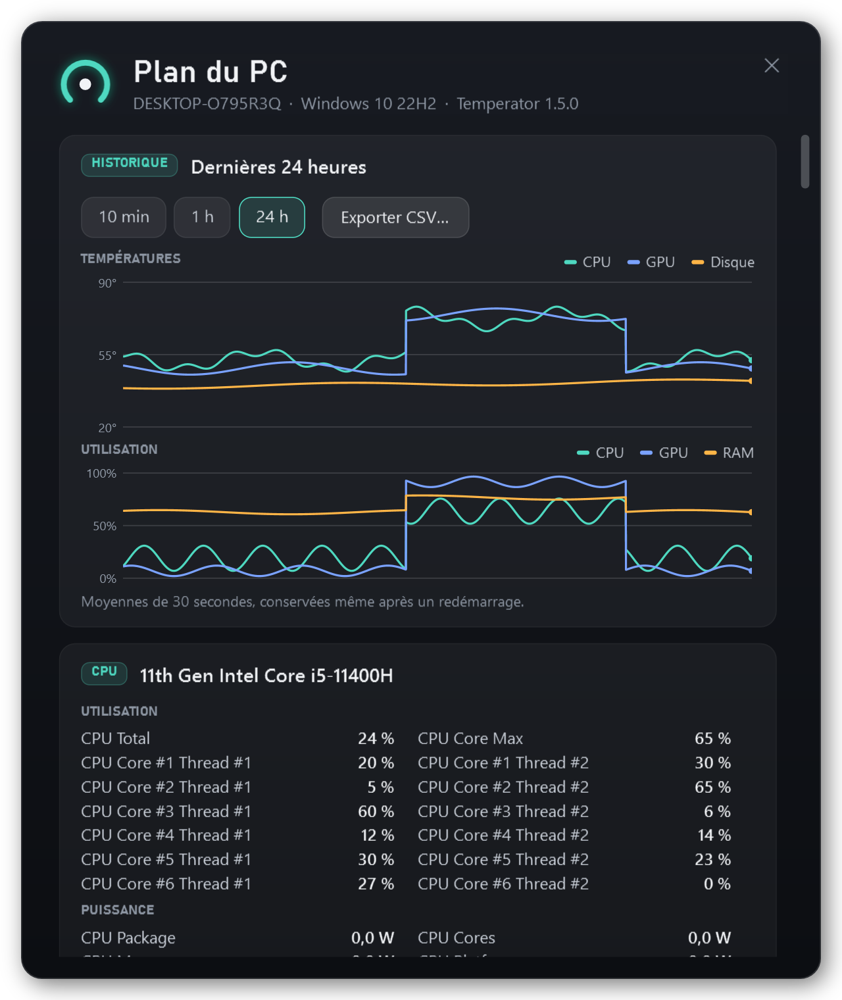

# Temperator

🇬🇧 [English version](README.en.md)

```text
  ______                                     __
 /_  __/__  ____ ___  ____  ___  _________ _/ /_____  _____
  / / / _ \/ __ `__ \/ __ \/ _ \/ ___/ __ `/ __/ __ \/ ___/
 / / /  __/ / / / / / /_/ /  __/ /  / /_/ / /_/ /_/ / /
/_/  \___/_/ /_/ /_/ .___/\___/_/   \__,_/\__/\____/_/
                  /_/
```

Les températures et l'utilisation de ton PC, toujours à l'écran : un petit widget discret en haut à droite.

<p align="center"></p>

## Ce qu'il affiche

- **CPU, GPU, RAM, disque, ventilateur** : température et utilisation, mises à jour chaque seconde.
- **Réseau** (réception ↓, envoi ↑), **batterie** des portables (niveau, en charge ou watts consommés),
  **consommation** du processeur et de la carte graphique en watts.
- **Couleurs** : turquoise quand tout va bien, orange quand ça chauffe, rouge quand c'est trop chaud.
  La couleur d'accent se change (bleu, violet, rose, vert, orange, blanc).
- **Jauges rondes** (par défaut) ou **lignes et barres**.
- Tu choisis la **carte graphique**, le **disque** et la **carte réseau** affichés, s'il y en a plusieurs.

<p align="center"></p>

## Ce qu'il sait faire

- **Flammes quand c'est trop chaud** : en jauges rondes, seule la jauge concernée prend feu ; en lignes, tout le bas du widget.
  Les **seuils** se règlent (certains processeurs de portables tournent normalement vers 90 °C).
- **Alerte Windows** quand un composant reste trop chaud plus de 30 secondes, même widget masqué.
- **Historique** : la courbe des 5 dernières minutes au survol d'une jauge, et dans le *Plan du PC* les 10 dernières minutes,
  la dernière heure ou les 24 dernières heures (conservées après un redémarrage), avec **export CSV** pour Excel.
- **Mode jeu** : quand un jeu ou une vidéo passe en plein écran, le widget devient compact (CPU et GPU seulement, fond léger),
  ou se masque, au choix.
- **Fond opaque, translucide ou absent** : en translucide et sans fond, le widget regarde l'écran autour de lui et passe en
  couleurs claires ou sombres pour rester lisible. L'**opacité du fond** se règle à part.
- **Au-dessus de tout, quoi qu'il arrive** : il repasse devant toute fenêtre qui le recouvre.
- **Clics traversants** : la souris passe à travers le widget (maintiens **Ctrl** pour le saisir).
- **Raccourci clavier** : **Ctrl+Alt+T** l'affiche ou le masque, de n'importe où.
- **Mises à jour automatiques** depuis GitHub, avec vérification de l'empreinte SHA-256.
- **Français ou anglais** : la langue de Windows par défaut, modifiable dans les réglages.

Glisse le widget pour le déplacer, **double-clic** pour le *Plan du PC*, **clic droit** pour le menu.
L'icône près de l'horloge le masque ou le réaffiche.

<p align="center">
  
  
</p>
<p align="center">
  
  
  
</p>
<p align="center"><sub>Trop chaud · historique au survol · translucide · sans fond · lignes et barres</sub></p>

## Simple ou complet

Au premier lancement, Temperator te demande comment tu veux l'utiliser :

- **Simple** (recommandé) : le widget prêt à l'emploi, avec un menu court (affichage, taille, premier plan, masquer).
- **Complet** : une fenêtre de **Réglages** avec toutes les options, rangées par onglets.

Tu peux changer à tout moment : clic droit → *Mode complet* en mode simple, ou *Réglages → Général* en mode complet.

<p align="center"></p>
<p align="center"></p>

## Installation

1. Télécharge **`Temperator-Setup-x.y.z.exe`** depuis la page [Releases](https://github.com/Buntasam/Temperator/releases/latest).
2. Lance-le et accepte la demande d'administrateur.
3. Choisis tes options, accepte la [licence](LICENSE), puis clique sur **Installer**.

<p align="center"></p>

L'installeur ajoute aussi ce qui manque :

| Composant | Pourquoi | Taille |
|---|---|---|
| [.NET 10 Desktop Runtime](https://dotnet.microsoft.com) (Microsoft) | fait tourner Temperator | environ 57 Mo |
| Pilote [PawnIO](https://pawnio.eu) (open source, signé) | température du CPU et ventilateurs | environ 3 Mo |

> **« Windows a protégé votre ordinateur » ?** L'installeur n'est pas signé numériquement, donc SmartScreen
> peut l'afficher. Clique sur *Informations complémentaires*, puis sur *Exécuter quand même*.
> L'empreinte SHA-256 de chaque version est publiée avec la release.

**Désinstaller** : *Paramètres → Applications → Temperator*, ou relance l'installeur et choisis *Désinstaller*.
.NET et PawnIO restent installés, car d'autres logiciels peuvent s'en servir.

**Installation silencieuse** : `Temperator-Setup-x.y.z.exe /S`. Options : `/noautostart /nodesktop /nolaunch`
(et `/uninstall /S` pour désinstaller sans fenêtre). Installer en silencieux revient à accepter la [licence](LICENSE).
Le journal est écrit dans `%TEMP%\temperator-setup.log`.

> Ce que Windows ne permet pas de recouvrir : le menu Démarrer, la recherche, Alt+Tab, le centre de notifications
> et les jeux en plein écran *exclusif*. Les jeux en mode « fenêtré sans bordure » fonctionnent.

## Plan du PC

Double-clic sur le widget : l'historique, puis tout le matériel détecté et tous ses capteurs, en direct.

<p align="center"></p>

## Un problème ?

*Réglages → Général → Rapport de diagnostic → Copier*, puis colle-le dans une [issue](https://github.com/Buntasam/Temperator/issues).
Il contient la version, Windows, le matériel détecté, les valeurs lues, les réglages et les dernières erreurs.

## Pour les développeurs

Il faut Windows 10/11 64 bits et le [SDK .NET 10](https://dotnet.microsoft.com/download/dotnet/10.0) (`winget install Microsoft.DotNet.SDK.10`).

```powershell
# lancer le widget (Debug : sans élévation, donc sans température CPU)
dotnet run --project src/Temperator

# construire l'installeur : dist\Temperator-Setup-<version>.exe, SHA256SUMS.txt et les manifestes winget
powershell -ExecutionPolicy Bypass -File build.ps1
```

| Dossier | Contenu |
|---|---|
| `src/Temperator` | le widget (WPF, .NET 10, [LibreHardwareMonitor](https://github.com/LibreHardwareMonitor/LibreHardwareMonitor)) |
| `src/Setup` | `Temperator-Setup.exe` : l'installeur (C#, WPF, .NET Framework 4.8), qui contient l'application |
| `tools/make-icon.ps1` | génère l'icône |

Captures d'écran : `Temperator.exe --snapshot <dossier> --demo` (ajoute `--en` pour l'anglais),
et `Temperator-Setup.exe /preview <dossier> /lang fr|en` (version Debug) pour l'installeur.

Les réglages sont dans `%ProgramData%\Temperator\settings.json`, l'historique dans `historique.csv` et les erreurs dans
`erreurs.log`, au même endroit.

**Publier une version** : change `<Version>` dans `src/Temperator/Temperator.csproj` et `src/Setup/Setup.csproj`, lance
`build.ps1`, puis joins à la release GitHub **`Temperator-Setup-x.y.z.exe` et `SHA256SUMS.txt`**. La mise à jour automatique
refuse d'installer une version sans empreinte SHA-256 correspondante.

**winget** : `build.ps1` prépare les manifestes dans `dist\winget\`. Une fois la release publiée, vérifie-les avec
`winget validate dist\winget\manifests\b\Buntasam\Temperator\<version>`, puis propose-les dans
[microsoft/winget-pkgs](https://github.com/microsoft/winget-pkgs) (par exemple avec `wingetcreate submit`).
Après acceptation : `winget install Buntasam.Temperator`.

## Contribuer

Les améliorations se proposent **uniquement sur GitHub**, par une issue ou une pull request : voir [CONTRIBUTING.md](CONTRIBUTING.md).

## Licence

Temperator n'est **pas open source**. Le code est visible, mais tous les droits sont réservés (voir [LICENSE](LICENSE)).

- ✅ Télécharger, installer et utiliser Temperator gratuitement, pour un usage personnel.
- ✅ Lire le code, et le modifier pour toi seul.
- ✅ Proposer des améliorations sur ce dépôt (fork uniquement pour ouvrir une pull request).
- ✅ Montrer le widget en capture, en vidéo ou en stream, et partager le lien vers ce dépôt.
- ❌ Republier, redistribuer ou héberger ailleurs Temperator, modifié ou non.
- ❌ Toute utilisation commerciale sans l'accord écrit de l'auteur.

Les composants tiers (LibreHardwareMonitor, HidSharp…) gardent leur propre licence : voir [LICENCES-TIERS.txt](LICENCES-TIERS.txt).
